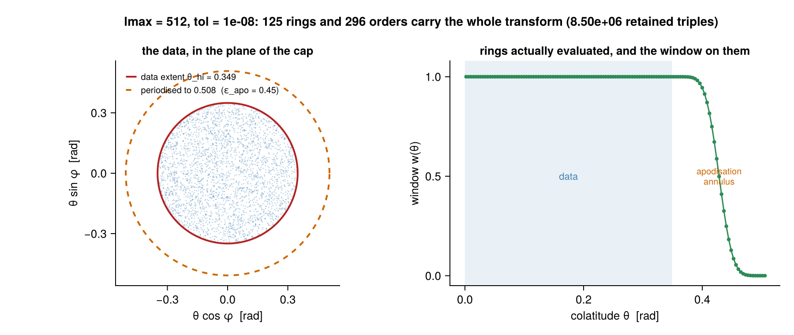
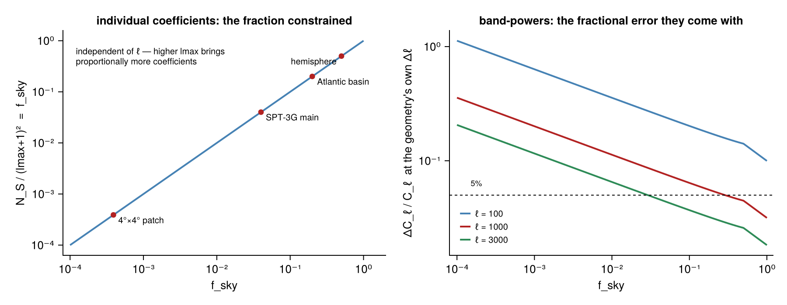

# PartialFSHT.jl

[](https://github.com/jbphyswx/PartialFSHT.jl/actions/workflows/CI.yml)
[](https://jbphyswx.github.io/PartialFSHT.jl/dev/)
[](https://codecov.io/gh/jbphyswx/PartialFSHT.jl)

Partial-sky spherical harmonic transforms: the operator

```math
(\mathcal{Y}_R a)_i = \sum_{\ell m} a_{\ell m} Y_{\ell m}(\Omega_i)
```

on an arbitrary point set, with its exact Euclidean adjoint. Coefficients are complex
orthonormal Condon–Shortley harmonics in FastSphericalHarmonics `sph_mode` layout.

```julia
using PartialFSHT: PartialFSHT
using LinearAlgebra: LinearAlgebra
using FINUFFT: FINUFFT                # or NonuniformFFTs — a fast NUFFT is required

plan = PartialFSHT.Plan(θ, φ; lmax = 2048, tol = 1e-8)
LinearAlgebra.mul!(f, plan, alm)      # synthesis
LinearAlgebra.mul!(alm, plan', f)     # exact adjoint
```

Runnable examples in [`examples/`](examples/); the manual is under [`docs/`](docs/src/).

<p align="center">
  
</p>

## Performance

Synthesis on a 20° polar cap with `M ≈ 4(L·θ⋆)²` points, `tol = 1e-8`, against a full-sphere
`NUFSHT.nusht_type2!` on the *same* points. Produced by `benchmark/calibrate.jl` on 4 physical
cores at `-t4`, with the machine otherwise idle. The NUFFT stage is a co-equal share of an apply
and the two backends differ measurably on it, so the benchmark sweeps both rather than quoting one.

| `lmax` | `M` | NUFFT | serial | threaded | NUFSHT | vs serial | vs threaded |
| ---: | ---: | --- | ---: | ---: | ---: | ---: | ---: |
| 256 | 3.2e4 | FINUFFT | 5.1 ms | 3.8 ms | 11.4 ms | 2.21× | 3.03× |
| 512 | 1.3e5 | FINUFFT | 20.5 ms | 11.2 ms | 57.2 ms | 2.79× | 5.09× |
| 1024 | 5.1e5 | FINUFFT | 112 ms | 58.6 ms | 283 ms | 2.52× | 4.83× |
| 2048 | 2.0e6 | FINUFFT | 538 ms | 245 ms | 2.05 s | 3.80× | **8.35×** |
| 256 | 3.2e4 | NonuniformFFTs | 5.7 ms | 4.5 ms | 11.6 ms | 2.02× | 2.57× |
| 512 | 1.3e5 | NonuniformFFTs | 23.8 ms | 14.1 ms | 56.1 ms | 2.36× | 3.97× |
| 1024 | 5.1e5 | NonuniformFFTs | 123 ms | 67.1 ms | 285 ms | 2.31× | 4.25× |
| 2048 | 2.0e6 | NonuniformFFTs | 609 ms | 290 ms | 2.09 s | 3.43× | 7.20× |

FINUFFT is the faster backend here at every size, by 6–13% end to end, and by considerably more on
plan construction: **0.24 s against 4.7 s** at `lmax = 2048`, since NonuniformFFTs' plan build
dominates that. Choose it unless you need the pure-Julia path (which is also the device-generic
one).

The ring pass carries **1.45 ns per retained `(degree, order, ring)` triple** and threads at
**2.3–3.6×** on four physical cores (3.2–3.5× at the two largest sizes), giving 1.4–2.2× end to
end — the rest of an apply is the NUFFT, which threads internally. The threaded result is
**bit-identical** to the serial one, since orders are independent and each is summed in the same
sequence regardless of which task runs it.

Batching raises arithmetic intensity, because one `P̄` value then feeds `2·ntrans` accumulations
against unchanged recurrence-state traffic — but only while the accumulators still fit in L1.
Measured cost per retained triple at `ntrans = 4` against `ntrans = 1`: **1.09× better at
`lmax = 512`, 1.12× at 1024, and 0.93× — a loss — at 2048**, where `nr × ntrans` complex
accumulators exceed L1 on this machine. Batch the smaller problems; at `lmax = 2048` it buys
nothing.

Plan construction at `lmax = 2048`, `M = 2e6` is **0.24 s** with FINUFFT for an explicitly requested
method. `AutoAlgorithm` adds the planner on top: 0.48 s and 92 MB for the partition search, which
sorts nothing — each largest gap comes from a bucketed `O(n)` scan.

**Allocation, precisely.** A serial apply with the NUFFT pinned to one thread is **exactly 0 B** in
both directions — every stage measured individually is 0 B, and `test/test_allocs.jl` gates that on
every leaf against an explicit `SerialBackend` with `DirectSumBackend`, so the gate measures this
package rather than a dependency.

Three things sit outside that boundary. Two are the same mechanism seen from different sides: FFTW.jl
installs a Julia-task threading callback into the shared FFTW library, so a multithreaded FFTW plan
spawns tasks on *every execution*.

- **Our FFT plans are built at one thread on purpose**, which is why the FFT stage is 0 B. The FFT
  is ~2% of an apply and the ring pass, threaded directly, is ~56%, so this costs almost nothing.
  `fft_threads` overrides it.
- **The fast NUFFT backends allocate per exec above one Julia thread.** FINUFFT's internal FFTW plan
  takes its thread count from its own OpenMP setting, and executing it goes through that same
  callback: 4032 B per apply at `lmax = 256`–512 and 900 kB at `lmax = 1024`, from `Task` objects
  — confirmed by allocation profiling, which names `FFTW.spawnloop` as the site. Pinning FFTW's
  *global* count while the NUFFT plans are built does not remove it. `nufft_kwargs = (nthreads = 1,)`
  does, at roughly twice the NUFFT time; which side of that trade is right depends on whether a
  solver's churn or its throughput matters more, so the package does not choose. NonuniformFFTs
  allocates per exec even single-threaded, from a `Threads.@threads` region in its deconvolution
  step. Both are upstream.
- **`ThreadedBackend` keeps a task-spawn floor** — OhMyThreads allocates a `Task` per slot on every
  call, ~3 kB at four threads. It is a *fixed* cost: it does not grow with `lmax`, `ntrans` or the
  point count, which is the property the example asserts. The work itself still allocates nothing.

## Accuracy

Delivered accuracy against direct associated-Legendre evaluation on the same points, reproduced by
[`examples/02_accuracy_and_tolerance.jl`](examples/02_accuracy_and_tolerance.jl):

| `lmax` | `tol = 1e-4` | `tol = 1e-8` | `tol = 1e-12` |
| ---: | ---: | ---: | ---: |
| 128 | 8.5e-6 | 3.9e-10 | refused |
| 256 | 1.1e-5 | 8.6e-10 | 3.7e-13 |
| 512 | 1.1e-5 | 2.3e-10 | 5.0e-13 |
| 1024 | 7.0e-6 | 1.3e-10 | 5.4e-13 |

Delivered error runs one to two decades *below* the request, because the budget is shared between
the window's spectral tail, the NUFFT tolerance and the grid rounding and none of them is tight.
"refused" is not a failure: a 20° cap at `lmax = 128` has `lmax·h < 2|ln tol|`, so the apodisation
would be wider than the data, and the construction says so instead of returning a loose answer.

The adjoint is the forward pipeline transposed stage by stage, so
`⟨𝒴a, f⟩ = ⟨a, 𝒴*f⟩` holds to round-off (2e-15) rather than to the transform tolerance. The
direct path is stable at every degree — `alf` agrees with `BigFloat` to 2e-12 at `ℓ = 8192`,
including orders near the turning point where a raw recurrence underflows to zero.

## Algorithm

```
alm ──ring ALF (polar-optimised, block-scaled)──▶ G[ring, m]
    ──apodise in θ──▶ periodise (DFS at a pole, two-sided otherwise)
    ──2-D FFT──▶ reduced Fourier torus ──type-2 NUFFT──▶ f(Ωᵢ)
```

Evaluate the degree-`lmax` field on the few rings that meet the data's colatitude interval,
apodise, periodise, interpolate. This is Carron & Reinecke's construction
([arXiv:2603.17166](https://arxiv.org/abs/2603.17166)) with **no coefficient rotation** — they
do not rotate either; they assume a frame with the patch at a pole. A per-apply Wigner rotation
costs about eight times the ring work it saves, which is enough to turn the method into a net
loss.

Geometry is a colatitude × longitude box: exactly minimal, `O(n)` (the largest circular gap comes
from a bucketed maximum-gap scan, not a sort), and it matches what the transform exploits — one
stretched interval per axis. An equatorial band is one box.

| method | when |
| --- | --- |
| `DirectAlgorithm` | scaled associated Legendre per point; the oracle, `O(M L²)` |
| `StretchAlgorithm` | one stretched colatitude interval — the workhorse |
| `MultiBoxAlgorithm` | one leaf per disjoint component of the point set |
| `NUFSHTAlgorithm` | full-sphere leaf via NUFSHT's public plans (needs `using NUFSHT`) |

`AutoAlgorithm` (the default) picks by *counted* cost — retained `(ℓ,m,ring)` triples, FFT
butterflies, NUFFT writes — with per-unit constants from `benchmark/calibrate.jl`.

Spin-`s` uses the same `Plan(...; spin = s)`; the Wigner-`d` there is the spin analogue of an
associated Legendre function (a degree recurrence at fixed `(m,−s)`), not a rotation.

NUFFT backends are types: `DirectSumBackend()` (reference), `FINUFFTBackend()`,
`NonuniformFFTsBackend()`, `AutoNUFFT()`. `AutoNUFFT` errors when no fast backend is loaded
rather than silently selecting the `O(M·n₁n₂)` reference — and only leaves that use a NUFFT
demand one, so a `DirectAlgorithm` plan needs no extension.

## Parallelism and devices

Execution backends come from ComputationalBackends.

| backend | what it parallelises | needs |
| --- | --- | --- |
| `SerialBackend` | — | — |
| `ThreadedBackend` | spherical harmonic order in the ring pass; boxes in a multi-box leaf | `using OhMyThreads` |
| `MPIBackend` | points across ranks — synthesis local, adjoint `Allreduce`d | `using MPI` |
| `DistributedBackend` | independent node sets across worker processes, via `mul_nodeset` | `using Distributed` |

The scalar ring pass, the spin ring pass and the DFS periodisation are KernelAbstractions kernels,
so they run on any device backend (`using KernelAbstractions`). Each parallelises over
`(ring, order)` with the whole recurrence state — including the block-scaling exponent — in
registers; the forward direction is race-free and reproduces the host result bit-for-bit, the
adjoint scatters through atomic adds and so agrees to round-off. An engine built from a host ring
vector but handed device buffers is **refused**, because that combination is a launch failure on
real hardware and would silently work on a CPU-backed backend.

**Validation status of the device path is worth being precise about.** All three kernels are tested
against the host on `JLArrays` in the normal suite. The FFT and NUFFT stages cannot be exercised
there — `JLArrays` provides no FFT — so an end-to-end device transform needs real hardware. Two
test entry points are deliberately separate from `runtests.jl`, because a single-rank or CPU-only
run of them would assert nothing:

```
mpiexec -n 2 julia --project=test test/mpi_ranks.jl    # MPI point decomposition
julia --project=test benchmark/calibrate.jl            # performance contract + cost constants
```

## What partial data can and cannot give you

Synthesis and the adjoint are exact at **any** sky coverage. Inversion is not, and the package
says so rather than returning numbers that look like truth.

```julia
r = PartialFSHT.recoverability(θ, φ, lmax)   # fsky, Shannon number, recoverable fraction, Δℓ
```

- **The local spectrum is recoverable, well.** With `N_w` wavelengths across the patch,
  wavenumbers are pinned to `≈1/N_w`; resolution is `Δℓ ≈ π/Λ`. A 3000 km basin observing
  `ℓ ≈ 1000` gives `Δℓ ≈ 7` and ~670 independent modes per band, i.e. band-powers to ~5%.
  Use `spectrum`, which accounts for the mask's own coupling.
- **Individual `a_ℓm` are not.** Only `~N_S = (lmax+1)²·f_sky` directions are constrained, and
  that fraction is `f_sky` *independently of `ℓ`* — small scales do not help, because higher `ℓ`
  brings proportionally more coefficients. It is a conditioning failure, not a uniqueness
  failure: exact noiseless data does determine the field, but the Slepian eigenvalues fall off a
  cliff past `N_S`.
- **`plan' * f` is not "the coefficients of my data."** It is the exact adjoint, and therefore
  the *masked* field's coefficients — mode-coupled and leakage-biased.

To compare partial observations against a global model in coefficient space, window both sides
identically — one extra forward transform — and compare in `(ℓ,m)`:

```julia
PartialFSHT.apply_resolution!(ã_model, plan, alm_model, w)   # A† W A
```

`solve!` names its regularisation (`:cg`, `:wiener`, `:minnorm`) because there is no
regularisation-free answer, and returns the Shannon number, `Δℓ`, iterations and residual
alongside the coefficients.

<p align="center">
  
</p>

The derivations are in [`docs/src/theory.md`](docs/src/theory.md), the full recoverability
discussion in [`docs/src/recoverability.md`](docs/src/recoverability.md), and the parts where a
correct algorithm can still be built wrongly in
[`docs/src/internals.md`](docs/src/internals.md).
