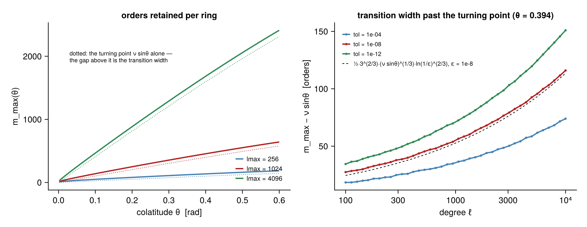
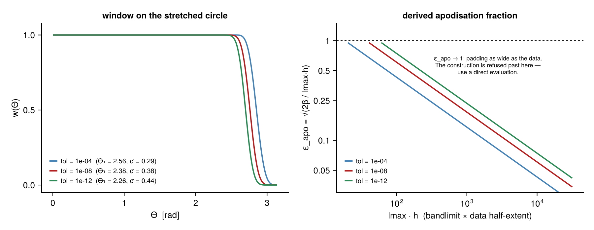
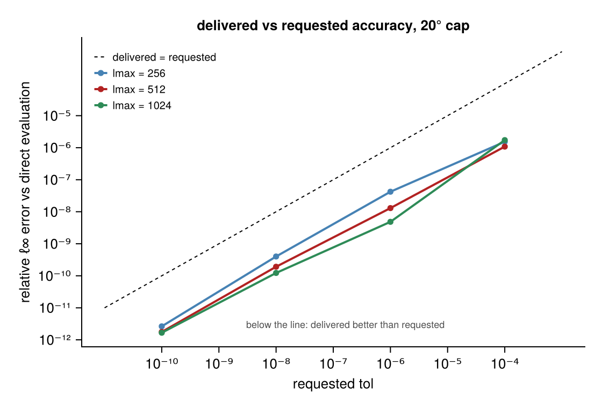
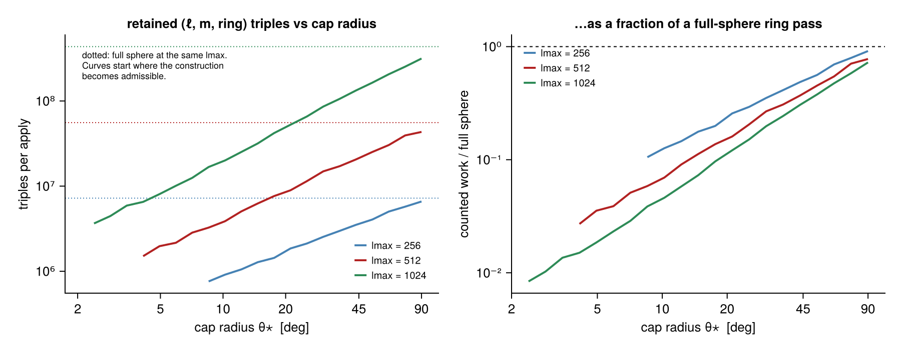

```@meta
CurrentModule = PartialFSHT
```

# Theory

## The operator

Synthesis on a point set ``R = \{\Omega_i\}``,

```math
(\mathcal{Y}_R a)_i = \sum_{\ell=0}^{L}\sum_{m=-\ell}^{\ell} a_{\ell m} Y_{\ell m}(\Omega_i),
```

with complex orthonormal Condon–Shortley harmonics, and the Euclidean adjoint

```math
(\mathcal{Y}_R^* f)_{\ell m} = \sum_i \overline{Y_{\ell m}(\Omega_i)} f_i .
```

Both are exact at any sky coverage. The adjoint is **not** a quadrature inverse; see
[Recoverability](recoverability.md).

## Scaled associated Legendre functions

Fully normalised ALFs with the Condon–Shortley sectorial sign follow the fixed-order,
increasing-degree recurrence

```math
\bar P_m^m = -\sqrt{\tfrac{2m+1}{2m}}\,\sin\theta\,\bar P_{m-1}^{m-1},\qquad
\bar P_{m+1}^m = \sqrt{2m+3}\,\cos\theta\,\bar P_m^m,
```

```math
\bar P_\ell^m = a_\ell^m \cos\theta\,\bar P_{\ell-1}^m - b_\ell^m \bar P_{\ell-2}^m .
```

The sectorial seed carries ``\sin^m\theta``, which flushes to zero in IEEE-754 long before it
stops mattering: on a 20° cap at ``L = 4096`` it vanishes at ``m = 801`` while orders out to
``m = 1636`` still hold 67% of the outer ring's Legendre energy. The recurrence is therefore run
in **block-scaled** form — one shared power-of-two exponent per ring chunk, renormalised on a
fixed stride — so the usable range is the exponent's rather than the mantissa's. Partial sums
are carried in the same scale, so the only terms dropped are ones already negligible against the
running maximum. Verified against `BigFloat` to ``2\times10^{-12}`` at ``\ell = 8192``.

## Polar optimisation

``\bar P_\ell^m(\cos\theta)`` turns evanescent at ``m \approx \nu\sin\theta``, ``\nu = \ell+1/2``.
Past the turning point the Bessel/Airy form gives ``|P| \sim \exp(-m(2\delta)^{3/2}/3)`` with
``\delta = m/(\nu\sin\theta) - 1``, so reaching a relative level ``\varepsilon`` needs

```math
m - \nu\sin\theta \;\gtrsim\; \tfrac12 3^{2/3} (\nu\sin\theta)^{1/3} \ln(1/\varepsilon)^{2/3}.
```



The transition width grows as ``\ell^{1/3}\ln(1/\varepsilon)^{2/3}`` — it is not a constant. At
``\ell = 4096``, ``\theta = 0.394``, ``\varepsilon = 10^{-8}`` it is 85 orders, so a fixed pad
silently over-truncates at high degree. Because ``\{\theta : \sin\theta \ge c\}`` is an interval,
the retained ring set for each order is *contiguous*, and the restriction is a reduction in work
rather than a mask on the accumulation.

## Apodisation and the stretched bandlimit

Let the data occupy a colatitude interval of half-extent ``h``, padded by ``1+\varepsilon_{\rm
apo}``, so the period is ``P = 2h(1+\varepsilon_{\rm apo})``. Mapping to ``\Theta \in [0,2\pi)``:

* ``e^{ik\theta}`` becomes ``\Theta``-frequency ``kP/2\pi``, so a degree-``L`` field carries
  ``|\Theta\text{-freq}| \le LP/2\pi``;
* the data's image is ``|\Theta - \Theta_c| \le \Theta_1`` with ``\Theta_1 = \pi/(1+\varepsilon_{\rm apo})``;
* the window must be one there and zero at the period boundary, forcing the ES half-width
  ``\sigma = (\pi-\Theta_1)/2``;
* an ES kernel of shape ``\beta`` and half-width ``\sigma`` has spectral support ``\lesssim
  \beta/\sigma`` and residual ``\sim e^{-\beta}``, so ``\beta = |\ln\varepsilon|`` and the product
  needs bandwidth ``K = LP/2\pi + \beta/\sigma``.

Substituting collapses to

```math
\varepsilon_{\rm apo} = \sqrt{\frac{2\beta}{L h}}, \qquad K = \frac{L h (1+\varepsilon_{\rm apo})^2}{\pi},
```



exactly when the window's spectral spread is what the extra bandwidth allowance pays for. This
reproduces Carron & Reinecke's ``\varepsilon^{\rm apo}`` and ``L_{\max}``, and shows what they
are: the unique choice making apodisation cost and bandwidth budget consistent at tolerance
``\varepsilon``. The window itself is an ES bell convolved with a top-hat, evaluated from a
converged cumulative distribution after the substitution ``z = \sin u`` that removes the kernel's
branch point at ``|z| = 1``.

## Periodisation

Three cases, chosen by which gives the smaller bandlimit rather than by a tolerance on "is
``\theta_{\rm lo}`` close enough to zero":

* **pole** — extend to ``[0,\theta_{\rm hi}]`` and reflect through the pole. The DFS identity
  ``f(-\theta,\varphi) = (-1)^s f(\theta,\varphi+\pi)`` is the analytic continuation of the field
  through the pole, hence exact, and only the far end needs apodising.
* **interior** — apodise both ends. Rejected if its margin would run past a pole: colatitude
  stops being a coordinate there, and letting such a candidate through caps accuracy at
  ``10^{-3}`` whatever tolerance is requested.
* **full** ``[0,\pi]`` — DFS at both poles, no window.

The longitude grid must be **even**. The DFS reflection realises ``\varphi \to \varphi+\pi`` as a
shift of ``N_\varphi/2`` cells, which is a half-turn only for even ``N_\varphi``; at
``N_\varphi = 135`` it shifts 3.118 rad instead of 3.1416 and caps accuracy at ``10^{-5}``. All
grid sizes are additionally rounded to 5-smooth.

## Why there is no rotation

Carron & Reinecke do not rotate coefficients — they assume a frame with the patch at a pole. A
per-apply Wigner rotation to output rows ``|m'| \le M`` is a dense ``\Theta(L^2 M)`` map, i.e.
``\Theta(L^3\theta_\star)`` with ``M \approx L\sin\theta_{\max}``, which is strictly worse than
the ``\Theta(L^3\theta_\star^2)`` ring pass it buys. Counted on a 20° cap at ``L = 2048``: the
rotation is ``6.9\times10^9`` units against ``2.7\times10^8`` for the ring pass — eight times the
work it saves, and twice an entire full-sphere transform. It cannot be hoisted out of the apply
(``a_{\ell m}`` is the input) nor cached (the thin ``d^\ell(\beta)`` table is 48 GB at
``L = 2048``). A frame with the patch at a pole is worth about 4× and is free to the caller, so
the package asks for it instead of faking it.

A southern periodisation is reflected to the north via
``Y_{\ell m}(\pi-\theta,\varphi) = (-1)^{\ell+m} Y_{\ell m}(\theta,\varphi)`` — one sign pass on
the coefficients — because increasing ``\Theta`` there maps to *decreasing* ``\theta`` and the
grid and the ring engine would otherwise disagree on order.

## The front end that was measured and rejected

There is an alternative to the associated-Legendre ring pass. Take ``a_{\ell m}`` to bivariate
Fourier coefficients with FastTransforms' `sph2fourier` — ``O(L^2\log^2 L)``, asymptotically
better than the ring pass's ``O(L^2 n_\theta)`` — and then reduce to the patch with a banded
operator. Writing ``u(\theta) = \sum_{|k|\le L} F_{k,m}e^{ik\theta}``, the periodised product
``v(\Theta) = u(c+\Theta/s)\,w(\Theta)`` has

```math
V_\kappa = \sum_k F_{k,m} e^{ikc}\, \hat W(\kappa - k/s),
\qquad \hat W(\xi) = \frac1{2\pi}\int_{-\pi}^{\pi} w(\Theta)e^{-i\xi\Theta}\,d\Theta,
```

and ``\hat W`` decays at the window's roll-off rate, so truncating to ``|\kappa - k/s| \le b/2``
with ``b = O(\log(1/\varepsilon) + \log L)`` makes the stretch a precomputed *banded* matrix whose
transpose is the exact adjoint — cost ``O(L^2 b)``, independent of patch position.

This was left conditional on measurement, and the measurement says do not build it. On one
machine at 8 threads, `sph2fourier` *alone* against the threaded ring pass it would replace:

| `lmax` | `sph2fourier` | ring pass (threaded) | ratio |
| ---: | ---: | ---: | ---: |
| 256 | 2.7 ms | 1.6 ms | 1.7× |
| 512 | 14.0 ms | 5.1 ms | 2.7× |
| 1024 | 90 ms | 29 ms | 3.1× |
| 2048 | 683 ms | 141 ms | 4.9× |

The better asymptotics do not pay at these degrees, and the gap *widens* with ``L``. The ring
pass stays the front end.

## The kernel shape that was measured and rejected

The ring pass runs the degree recurrence as a SIMD loop *across rings*, holding the two-term
state in arrays, and fuses the accumulation into the same loop. The obvious alternative — the
shape libsharp-style kernels use — is to put the ring loop outermost in blocks of a few rings and
the degree loop innermost, so the state and the partial sums never leave registers. On paper that
removes two stores per ring per degree.

Measured, it is **2× slower** (2.23–2.53 ns per triple against 1.24 for an idealised version of
the current shape). The reason is that the current loop vectorises across the whole ring chunk —
hundreds of contiguous elements — while a hand-unrolled block of four caps instruction-level
parallelism at four and the compiler cannot widen it. The state is L1-resident either way, so the
stores the restructure would have removed are cheap next to the FMA throughput the wide loop
gains.

What *did* pay was fusing the recurrence with its accumulation so the new value is consumed in
the register that produced it: 1.88 → 1.54 ns per triple, and 1.57× on the threaded stage.

The remaining distance to peak is arithmetic intensity, not scheduling. Each triple is five FMAs
against roughly fifteen doubles of L1 traffic, and the only structural way to raise that ratio is
batching — one `P̄` value then feeds `2·ntrans` accumulations against unchanged state traffic.

That works while the accumulators still fit in L1, and stops when they do not. Cost per retained
triple at `ntrans = 4` against `ntrans = 1`, measured: 1.09× better at ``\ell_{\max} = 512``, 1.12×
at 1024, and **0.93× — a loss —** at 2048, where ``n_r \times`` `ntrans` complex accumulators
exceed L1.

Batching must also not be implemented by fusing. Fusing puts the batch loop innermost, where
`accp[k, b]` strides by ``n_r`` in ``b``; that measured **0.64× at `ntrans = 2`**, because the
strided inner loop cannot vectorise and the outer loop then cannot either. The batched path
therefore keeps the two-pass form, with every accumulation contiguous in the ring index — the axis
worth vectorising. Only the single-transform path fuses.

## Spin

```math
{}_sY_{\ell m}(\theta,\varphi) = N_\ell\, d^\ell_{m,-s}(\theta)\, e^{im\varphi},
\qquad N_\ell = \sqrt{\tfrac{2\ell+1}{4\pi}} .
```

The Wigner-``d`` here is the spin analogue of an associated Legendre function — a three-term
recurrence in *degree* at fixed ``(m,-s)`` — not a rotation. It is seeded at
``\ell_0 = \max(|m|,|s|)``, where the ``d^{\ell_0-1}`` coefficient vanishes identically, from the
extremal closed form

```math
d^\ell_{m,\ell}(\beta) = \sqrt{\binom{2\ell}{\ell-m}} \cos^{\ell+m}\tfrac\beta2 \sin^{\ell-m}\tfrac\beta2,
```

with ``d^\ell_{m,-\ell}`` picking up ``(-1)^{\ell-m}``, and block-scaled exactly as the ALF
recurrence so ``\sin^{\ell+m}(\beta/2)`` never underflows. ``\ell_0 = 0`` needs its own two seeds
because the degree recurrence divides by ``\ell``.

## Delivered accuracy

Everything above is a claim about an error budget, so here is the budget spent, against direct
associated-Legendre evaluation on the same points:



And the work the polar optimisation actually removes, counted rather than timed:



## References

- Carron & Reinecke, *Fast partial-sky spherical harmonic transforms*, [arXiv:2603.17166](https://arxiv.org/abs/2603.17166).
- Reinecke, Belkner & Carron, A&A 678 A165 (2023) — Fourier-sphere + NUFFT at arbitrary pixels.
- Reinecke & Seljebotn, A&A 554 A112 (2013) — polar optimisation.
- Barnett, Magland & af Klinteberg, SISC 41 (2019) — the ES kernel.
- Holmes & Featherstone, J. Geod. 76 (2002) — scaled ALF recurrences.
- Trapani & Navaza, Acta Cryst. A62 (2006) — Wigner-``d`` recurrences.
- Simons, Dahlen & Wieczorek, SIAM Rev. 48 (2006) — spherical concentration and the Shannon number.
- Hivon et al., ApJ 567 (2002) — pseudo-``C_\ell`` mode coupling.
